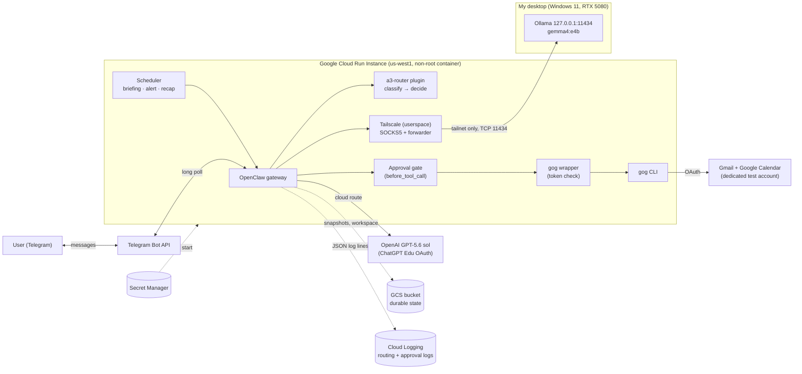
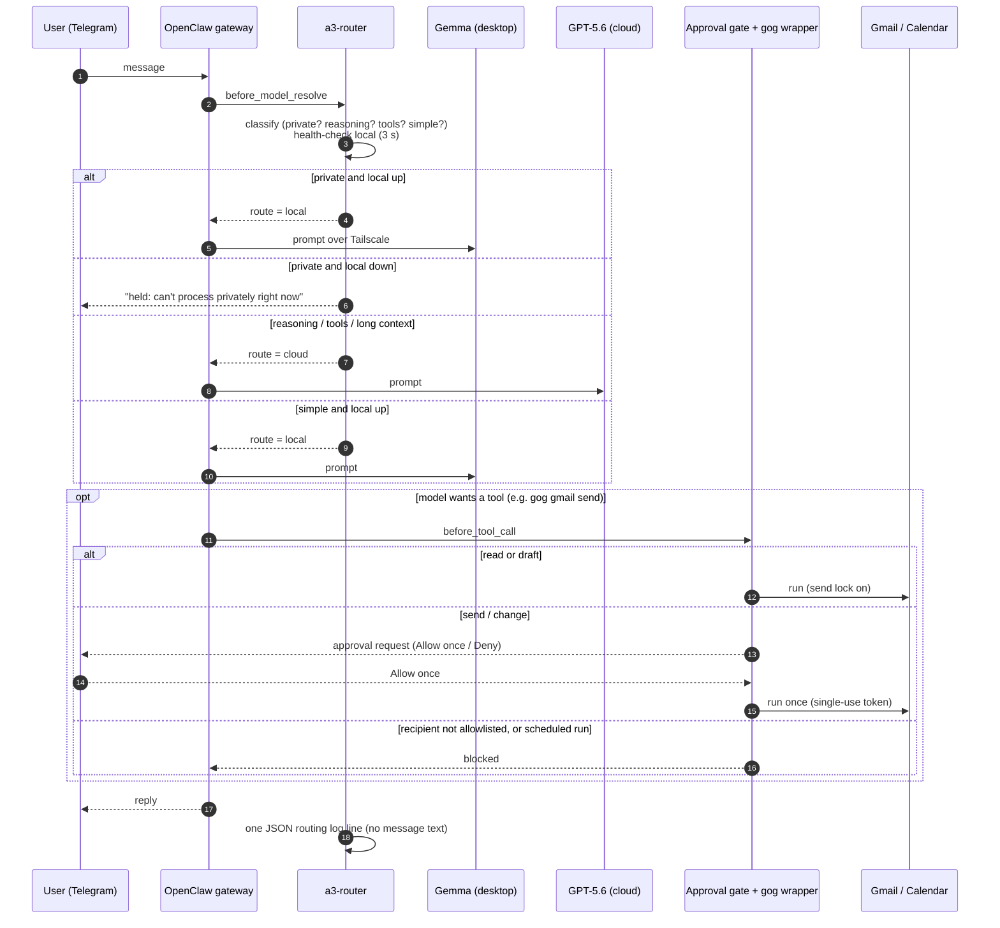

# Personal-Agent: a hybrid-LLM personal assistant

A personal assistant you message on Telegram. It answers questions, reads and drafts email,
checks a calendar, and sends a morning briefing, timely alerts and an end-of-day recap without
being asked. Each request is answered by either a **local model on my own desktop** or a
**cloud model**, chosen per message by a deterministic router. Anything private stays on my
machine, and nothing is ever emailed without a human tap on an approval button.

Built for USC CSCI 599 (Agentic AI), Assignment 3. All accounts and personal data in this
project are test accounts and fictitious data.

The code lives in [`a3-agent/`](a3-agent/). Its [README](a3-agent/README.md) has the exact
routing rules, deploy steps and operating notes.

## What it does

| Capability | How |
|---|---|
| Chat over Telegram | One allowlisted Telegram user; everyone else is ignored |
| Hybrid routing | Short, simple or private requests → local **Gemma 4 (e4b)**; reasoning, long context and tool use → cloud **GPT-5.6 (sol)** |
| Privacy | Private requests never go to the cloud. If the local model is offline they are **held**, not sent anywhere |
| Email and calendar | Gmail and Google Calendar on a dedicated test account through the `gog` CLI: read, search, draft |
| Human approval | Every send, and every change to mail or calendar, waits for an **Allow once** tap in Telegram, and only to allowlisted recipients |
| Scheduled jobs | Morning briefing 7:30 AM, a proactive alert check every 15 minutes, end-of-day recap 6:00 PM (Pacific) |
| Memory and persona | Remembers facts across conversations and restarts; persona and user profile in `workspace/` |
| Evidence | Every routing decision and approval decision is one JSON log line, with no message text |

## Architecture



### One request, step by step



## How it works

**Routing.** The `a3-router` OpenClaw plugin classifies each message with deterministic keyword
and length rules (no model call), then applies ordered rules where the first match wins:
private → local, or **held** if local is down; a private session stays private; reasoning or
long context → cloud; cloud rate-limited → local; tool use (calendar, email, search, weather)
→ cloud; simple → local; everything else → cloud. Cloud errors (404, 429, 5xx, errors mid-stream)
trigger a cooldown, not retry loops. A reversible switch simulates a 429 without using real quota.

**Local model link.** Ollama listens only on `127.0.0.1` on the desktop and is published to the
tailnet with `tailscale serve` (never Funnel). The tailnet ACL lets the tagged cloud node reach
only `desktop:11434`. In the container, Tailscale runs in userspace mode and the agent reaches
Gemma through a loopback SOCKS5 proxy.

**Human approval.** Two independent layers enforce it in code. A plugin hook pauses any send or
change and asks the human in Telegram; only **Allow once** creates a single-use token for that
exact action and those recipients. The command named `gog` in the image is a wrapper that refuses
any send or change without that token, so a command the hook misses still cannot send. Runs
started by the scheduler are never offered approval.

**Untrusted input.** Email bodies, calendar descriptions and web pages are treated as data, not
instructions. Even if one tricks the model, it cannot send mail on its own: the approval gate
and recipient allowlist sit outside the model.

**State and secrets.** Durable state (OpenClaw snapshots, workspace files, evidence) lives on a
GCS bucket mount; active databases stay on local disk and are snapshotted on shutdown. Secrets
(bot token, gateway key, Tailscale key, gog keyring password) come from Secret Manager at start
and are never in code, images, logs or git.

## Repository layout

```
a3-agent/
  src/router/      classifier, ordered routing rules, cooldowns, private sessions
  src/plugin/      OpenClaw plugin entry and hook wiring
  src/approval/    approval gate, gog command policy, single-use tokens, gog wrapper
  src/local/       local health check and SOCKS forwarder to the desktop
  src/logging/     structured routing log
  config/          OpenClaw config patches and scheduled-job prompts
  container/       entrypoint, scheduled-job helper (a3job)
  deploy/          deploy.ps1 (gcloud beta run instances only)
  workspace/       SOUL.md, USER.md, IDENTITY.md (fictitious persona)
  tests/           unit tests: routing rules incl. HELD, approval gate, allowlist, injection cases
```

## Stack

OpenClaw 2026.10.9 on Node 24.22.1 · Google Cloud Run Instances (2 vCPU / 4 GiB, us-west1) ·
Ollama with `gemma4:e4b` on an RTX 5080 · Tailscale · Telegram · gogcli 0.48.0 · TypeScript (strict),
Vitest, ESLint, Prettier.

## Run it yourself

See [`a3-agent/README.md`](a3-agent/README.md) for deploy, the routing-log command, the
rate-limit switch and how to run the scheduled jobs. Credentials are never committed; copy
`a3-agent/.env.example` and load real values into Secret Manager.
